# Over the Hill LAN Co-op

<p align="center">
  <a href="https://github.com/Sergaris/over-the-hill-lan-coop/releases/latest"></a>
</p>

---

## Download and install

<h3><a href="https://github.com/Sergaris/over-the-hill-lan-coop/releases/latest">⬇ Download OTH-LAN (latest release)</a></h3>

No GitHub knowledge needed:

1. Open **[the latest release](https://github.com/Sergaris/over-the-hill-lan-coop/releases/latest)** (on the repository page it is also under **Releases** in the right-hand column).
2. Scroll down to **Assets** and click **`OTH-LAN-<version>.zip`**. Do **not** click "Source code (zip)": that is the program code, not the mod.
3. Unpack the downloaded zip (right-click → *Extract All…*).
4. Close the game, run **`OTH-LAN-Setup.exe`** and press **Install**.
5. Start Over The Hill from Steam and open **Main menu → Local Co-op**.

## Скачать и установить

<h3><a href="https://github.com/Sergaris/over-the-hill-lan-coop/releases/latest">⬇ Скачать OTH-LAN (последний релиз)</a></h3>

Знать GitHub не нужно:

1. Откройте **[последний релиз](https://github.com/Sergaris/over-the-hill-lan-coop/releases/latest)** (на странице репозитория он также есть справа, в блоке **Releases**).
2. Прокрутите вниз до **Assets** и нажмите **`OTH-LAN-<версия>.zip`**. **Не** нажимайте «Source code (zip)»: это исходный код программы, а не мод.
3. Распакуйте скачанный архив (правой кнопкой → «Извлечь всё…»).
4. Закройте игру, запустите **`OTH-LAN-Setup.exe`** и нажмите **«Установить»**.
5. Запустите Over The Hill через Steam и откройте **главное меню → «Локальный кооп»**.

---

## What it is

Unofficial **LAN / virtual-LAN co-op mod for Over The Hill** (Steam App 2929250); the mod itself is called **OTH-LAN**. Friends play the game's own multiplayer directly over a LAN or a virtual LAN (Radmin VPN, Hamachi, ZeroTier) instead of Photon Cloud. One player hosts, the others pick the host from the **Local Co-op** list in the main menu or join by IP. Every player must run the same game build and the same mod version.

> **Not affiliated with, endorsed by, or supported by Funselektor Labs or Exit Games (Photon).** This is a fan project. Do not contact the game's developers about problems caused by this mod: uninstall it first and check whether the problem persists.

- **It is** a BepInEx 6 (IL2CPP) plugin plus a small Windows installer. Together they let the game's own Photon Fusion multiplayer run over a direct UDP connection to the host's (virtual) LAN IP.
- **It isn't** a crack, a way to play without owning the game, a cheat, a dedicated server or an internet matchmaking service. It contains **no game files**, neither in this repository nor in the releases; every player needs their own legally purchased copy of Over The Hill.
- It does not modify any game file. It adds BepInEx next to the game, and the uninstaller restores the folder exactly.

## Что это

Неофициальный **мод для кооператива в Over The Hill по локальной или виртуальной сети** (Steam App 2929250); сам мод называется **OTH-LAN**. Друзья играют в штатный мультиплеер игры напрямую по локальной сети или виртуальной сети (Radmin VPN, Hamachi, ZeroTier) вместо Photon Cloud. Один игрок — хост, остальные выбирают его в списке **«Локальный кооп»** в главном меню или подключаются по IP. У всех игроков должны совпадать сборка игры и версия мода.

> **Мод не связан с Funselektor Labs и Exit Games (Photon), не одобрен и не поддерживается ими.** Это фанатский проект. Не обращайтесь к разработчикам игры с проблемами, вызванными модом: сначала удалите его и проверьте, осталась ли проблема.

- **Это** плагин BepInEx 6 (IL2CPP) и небольшой установщик для Windows. Вместе они позволяют штатному мультиплееру игры (Photon Fusion) работать через прямое UDP-соединение с IP хоста в (виртуальной) локальной сети.
- **Это не** кряк, не способ играть без купленной игры, не чит, не выделенный сервер и не интернет-подбор игроков. Здесь **нет файлов игры** — ни в репозитории, ни в релизах; каждому игроку нужна своя законно купленная копия Over The Hill.
- Мод не изменяет файлы игры. Он добавляет BepInEx рядом с игрой, а удаление возвращает папку точно в прежнее состояние.

---

## Screenshots

| | |
|---|---|
| 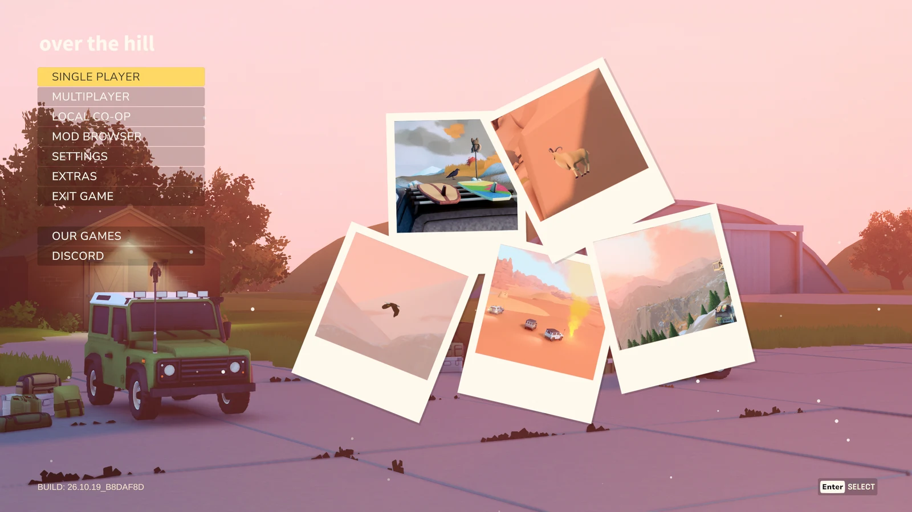<br>*Main menu: the mod adds a **Local Co-op** button below Multiplayer.* | 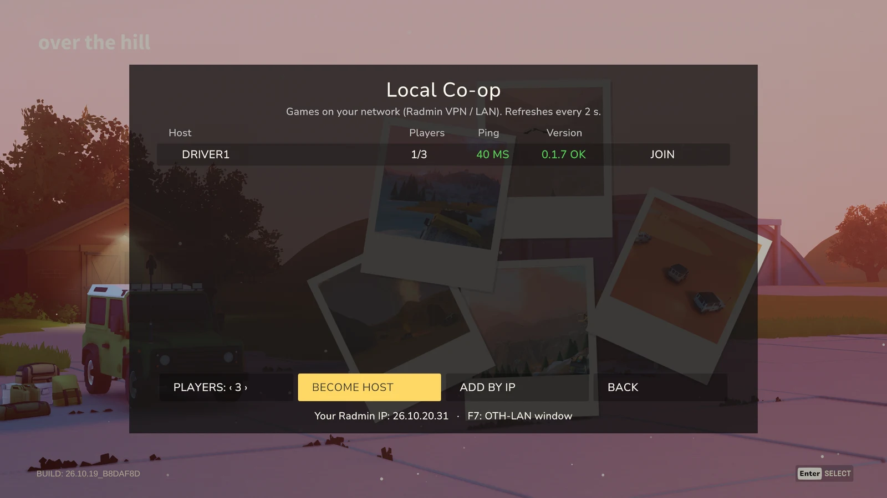<br>*Local Co-op: games on your LAN / virtual LAN with players, ping and mod version.* |
| 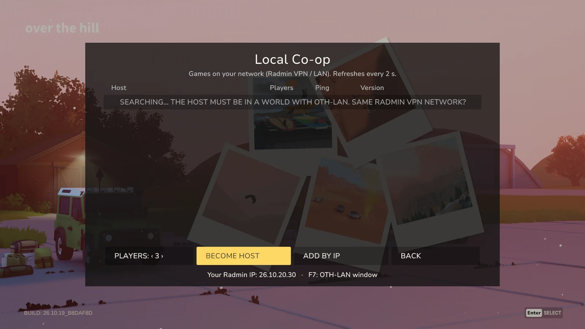<br>*Hosting: pick 2–4 players and press **Become host**; the game's own region and area selection follows.* | 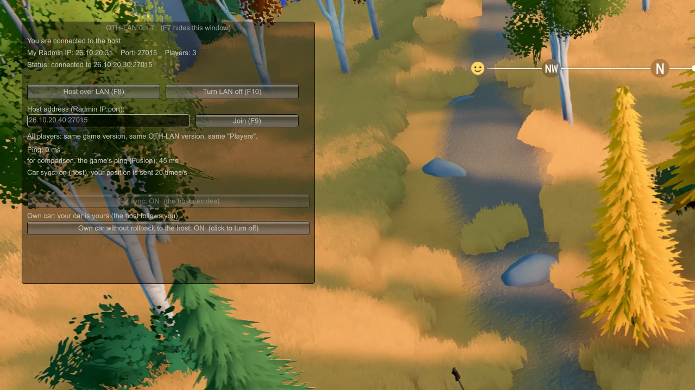<br>*F7 window: connection status, manual IP join, ping, CarSync and own-car switches.* |
| 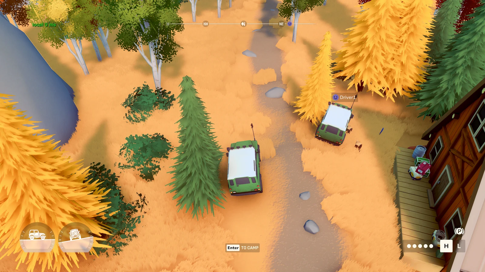<br>*In a session: the friend's car next to yours, driven over the direct connection.* | <br>*The ping label next to the game's connection icon: green ≤ 200 ms, yellow 200–300 ms, red > 300 ms, and "no link N s" when the host stops answering.* |
| 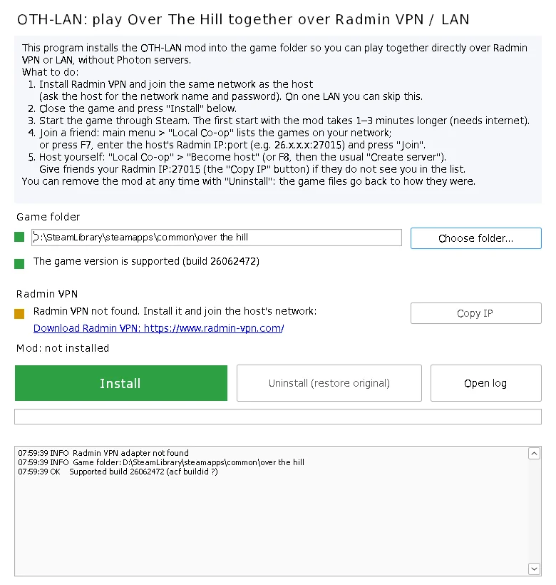<br>*The installer (shown under Wine; on Windows it uses the native look).* | |

All mod texts follow the language selected in the game. Screenshots were taken in demo mode with placeholder player names and addresses (Driver1/Driver2, 26.10.20.x).

## Скриншоты

| | |
|---|---|
| 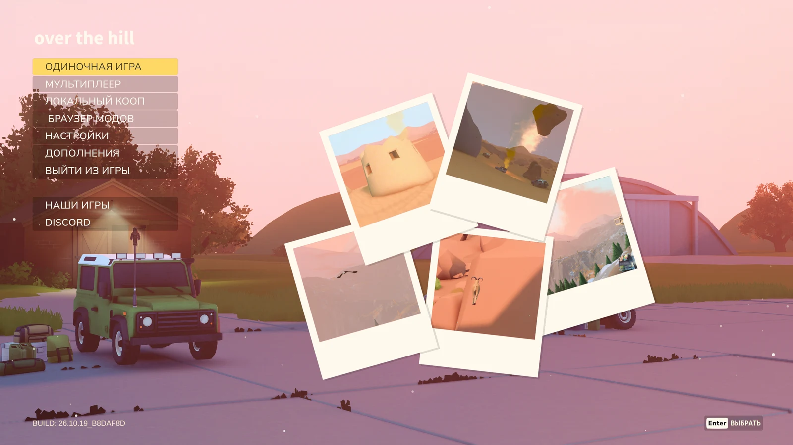<br>*Главное меню: мод добавляет кнопку **«Локальный кооп»** под «Мультиплеером».* | 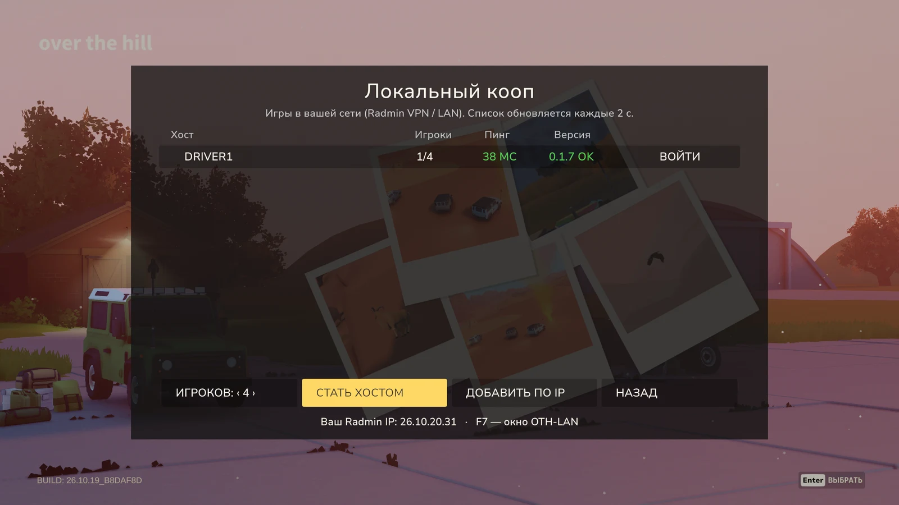<br>*«Локальный кооп»: игры в вашей локальной / виртуальной сети с игроками, пингом и версией мода.* |
| 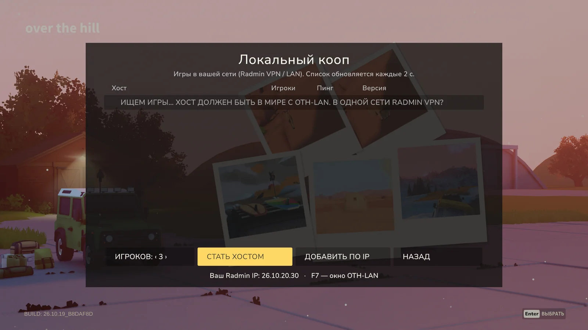<br>*Хост: выберите 2–4 игроков и нажмите **«Стать хостом»**; дальше — штатный выбор региона и местности.* | 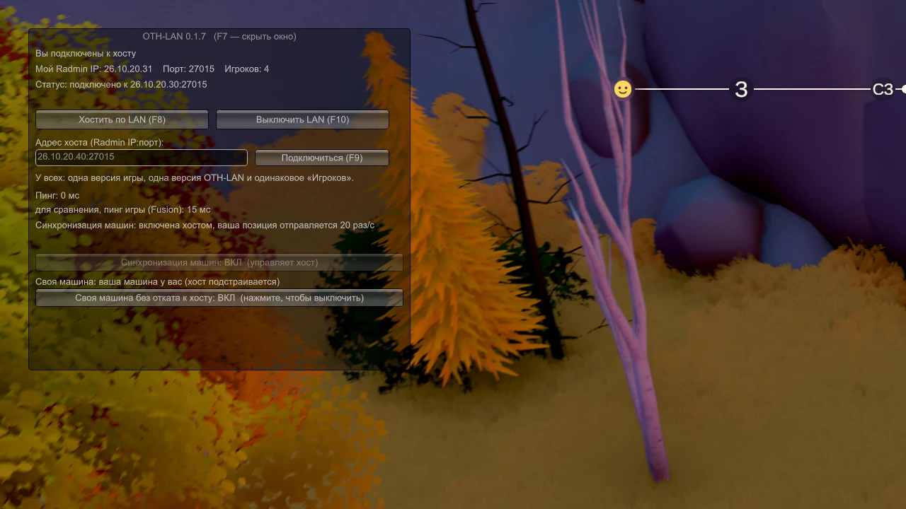<br>*Окно F7: состояние подключения, подключение по IP вручную, пинг, переключатели CarSync и своей машины.* |
| 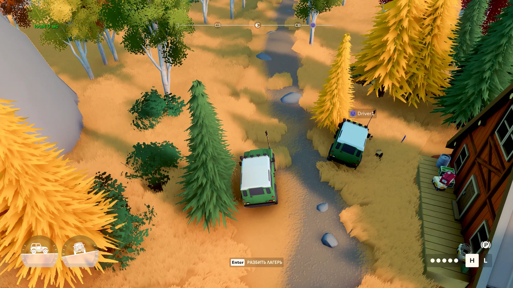<br>*В сессии: машина друга рядом с вашей, управление идёт по прямому соединению.* | 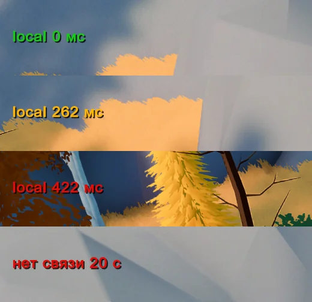<br>*Метка пинга рядом со значком соединения игры: зелёная ≤ 200 мс, жёлтая 200–300 мс, красная > 300 мс и «нет связи N с», когда хост перестал отвечать.* |
| 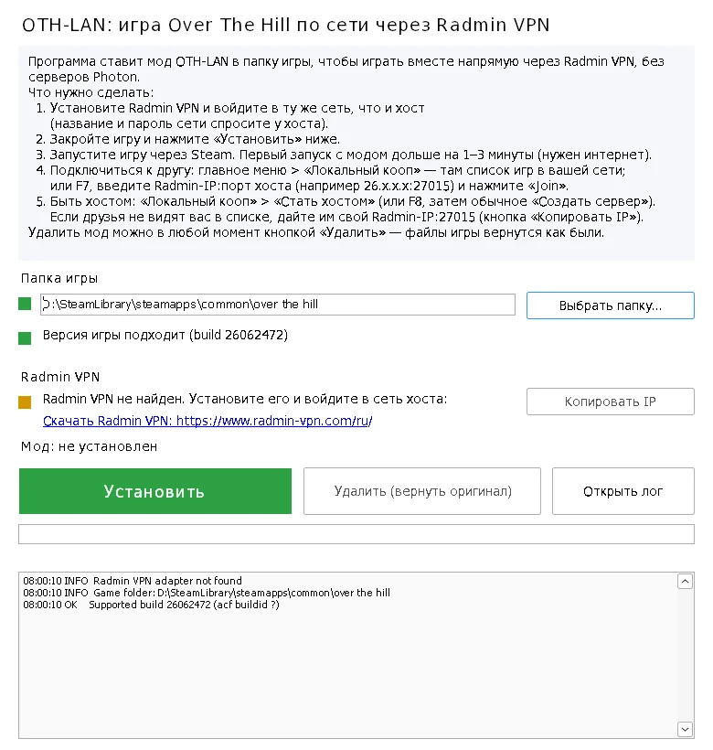<br>*Установщик (снят под Wine; в Windows он выглядит как обычное окно системы).* | |

Все тексты мода следуют языку, выбранному в игре. Скриншоты сняты в демо-режиме с условными именами игроков и адресами (Driver1/Driver2, 26.10.20.x).

---

## Requirements

- Windows 10/11 x64, Over The Hill from Steam. Every player must run the **same game build** and the **same mod version**; the client compares both with the host before joining and refuses with a message if they differ.
- A network all players share: a real LAN, or a virtual LAN such as Radmin VPN (https://www.radmin-vpn.com/), Hamachi (https://vpn.net/) or ZeroTier (https://www.zerotier.com/).
- Internet access on the first game start after installing: BepInEx downloads Unity's base libraries itself (from `unity.bepinex.dev`).

### Game versions

The mod is tested against the game builds listed in `manifest/supported-builds.json`. After a game update:

- if the networking code the mod hooks and the data layouts it reads are unchanged, the game asks once *"Game updated, not tested on this version"*: **Continue at own risk** or **Disable for now** (remembered per build);
- otherwise LAN mode stays off and F7 says the version is incompatible until the mod is updated.

## Требования

- Windows 10/11 x64, Over The Hill из Steam. У всех игроков должны быть **одна сборка игры** и **одна версия мода**; клиент сверяет обе с хостом перед подключением и при расхождении отказывает с сообщением.
- Общая для всех игроков сеть: настоящая локальная сеть или виртуальная, например Radmin VPN (https://www.radmin-vpn.com/), Hamachi (https://vpn.net/) или ZeroTier (https://www.zerotier.com/).
- Интернет при первом запуске игры после установки: BepInEx сам скачивает базовые библиотеки Unity (с `unity.bepinex.dev`).

### Версии игры

Мод проверен на сборках игры из `manifest/supported-builds.json`. После обновления игры:

- если сетевой код, который перехватывает мод, и данные, которые он читает, не изменились, игра один раз спросит *«Игра обновилась, эта версия не проверена»*: **«Продолжить на свой риск»** или **«Пока отключить»** (запоминается для каждой сборки);
- иначе режим LAN остаётся выключенным, и F7 сообщает, что версия несовместима, пока мод не обновят.

---

## Install

1. Download `OTH-LAN-<version>.zip` from [Releases](https://github.com/Sergaris/over-the-hill-lan-coop/releases/latest) (under **Assets**, not "Source code") and unpack it.
2. Close the game and run `OTH-LAN-Setup.exe`. It finds the game through Steam (or you pick the folder with `over the hill.exe`), checks the game version, installs BepInEx 6 (be.788) and the plugin, and adds a firewall rule.
3. Start the game from Steam. The first start takes 1–3 minutes longer while BepInEx prepares itself.

The installer is not code-signed. If SmartScreen shows "Windows protected your PC", click *More info* → *Run anyway*, but only for a file downloaded from this repository's [Releases](https://github.com/Sergaris/over-the-hill-lan-coop/releases) (compare the SHA-256 in the release notes).

**Why administrator rights?** The installer writes into the game folder (often under `Program Files`) and adds one Windows Firewall rule for the game (UDP 27015–27016):

```
netsh advfirewall firewall add rule name="OTH-LAN UDP 27015" dir=in action=allow protocol=UDP localport=27015,27016 program="<game folder>\over the hill.exe" profile=any enable=yes
```

It changes nothing else system-wide. Files it would overwrite are backed up to `<game>/OTH-LAN/` first.

**Installer language:** the installer runs before the game, so it cannot know the game's language. It follows the Windows display language (Russian if Windows is in Russian, English otherwise); `OTH-LAN-Setup.exe --lang en|ru` overrides it.

## Установка

1. Скачайте `OTH-LAN-<версия>.zip` из [Releases](https://github.com/Sergaris/over-the-hill-lan-coop/releases/latest) (в блоке **Assets**, не «Source code») и распакуйте.
2. Закройте игру и запустите `OTH-LAN-Setup.exe`. Он находит игру через Steam (или вы указываете папку с `over the hill.exe`), проверяет версию игры, ставит BepInEx 6 (be.788) и плагин и добавляет правило брандмауэра.
3. Запустите игру через Steam. Первый запуск дольше на 1–3 минуты, пока BepInEx готовится.

Установщик не подписан цифровой подписью. Если SmartScreen пишет «Система Windows защитила ваш компьютер», нажмите «Подробнее» → «Выполнить в любом случае», но только для файла, скачанного из [Releases](https://github.com/Sergaris/over-the-hill-lan-coop/releases) этого репозитория (сверьте SHA-256 из описания релиза).

**Зачем права администратора?** Установщик пишет в папку игры (часто она в `Program Files`) и добавляет одно правило брандмауэра Windows для игры (UDP 27015–27016):

```
netsh advfirewall firewall add rule name="OTH-LAN UDP 27015" dir=in action=allow protocol=UDP localport=27015,27016 program="<game folder>\over the hill.exe" profile=any enable=yes
```

Больше он ничего в системе не меняет. Файлы, которые он заменил бы, сначала сохраняются в `<game>/OTH-LAN/`.

**Язык установщика:** установщик запускается до игры, поэтому не знает её языка. Он следует языку интерфейса Windows (русский, если Windows на русском, иначе английский); `OTH-LAN-Setup.exe --lang en|ru` задаёт язык явно.

---

## Play

1. Everyone joins the same LAN / virtual network.
2. **Host:** main menu → **Local Co-op** → **Become host** → choose 2–4 players, then the usual region and area selection.
3. **Others:** main menu → **Local Co-op**. Hosts on the network appear in the list with name, players, ping and mod version; select one and press **Join**. If a host does not show up (some VPN setups drop broadcasts), use **Add by IP** with the host's `IP:27015`.
4. **F7** opens the mod window: manual IP join, status, diagnostics and the CarSync switch (the host decides). F8 / F9 / F10 are shortcuts: arm hosting, join the last address, turn LAN mode off.

During a session the label next to the game's connection icon shows `local NN ms`, the direct ping to the host.

## Игра

1. Все подключаются к одной локальной / виртуальной сети.
2. **Хост:** главное меню → **«Локальный кооп»** → **«Стать хостом»** → выберите 2–4 игроков, затем обычный выбор региона и местности.
3. **Остальные:** главное меню → **«Локальный кооп»**. Хосты в сети появляются в списке с именем, игроками, пингом и версией мода; выберите хост и нажмите **«Войти»**. Если хоста нет в списке (некоторые VPN не пропускают широковещательные пакеты), нажмите **«Добавить по IP»** и введите `IP:27015` хоста.
4. **F7** открывает окно мода: подключение по IP вручную, статус, диагностика и переключатель CarSync (решает хост). F8 / F9 / F10 — быстрые клавиши: включить хостинг, подключиться к последнему адресу, выключить режим LAN.

Во время сессии метка рядом со значком соединения игры показывает `local NN мс` — прямой пинг до хоста.

---

## Language

All mod texts (F7 window, Local Co-op screen, ping label, dialogs) follow the language selected in the game's settings and switch immediately, without a restart. English and Russian are complete; other game languages fall back to English. To add a language, copy `src/OthLan.Plugin/Lang/en.json` to `<code>.json` (the game's locale code, e.g. `de`, `pt-BR`, `zh-Hans`) and translate the values; the unit tests check that keys and `{0}` placeholders match.

## Язык

Все тексты мода (окно F7, экран «Локальный кооп», метка пинга, диалоги) следуют языку, выбранному в настройках игры, и переключаются сразу, без перезапуска. Английский и русский переведены полностью; остальные языки игры пока показываются по-английски. Чтобы добавить язык, скопируйте `src/OthLan.Plugin/Lang/en.json` в `<code>.json` (код языка игры, например `de`, `pt-BR`, `zh-Hans`) и переведите значения; юнит-тесты проверяют, что ключи и заполнители `{0}` совпадают.

---

## Updates

From 0.1.8 on, the mod checks this repository's latest release once per game start (5 s timeout, nothing happens when offline). When a newer version exists, the main menu offers **Install / Later / Skip this version**. Install downloads `OTH-LAN-<version>.zip` from the release, checks its sha256 against `SHA256SUMS.txt` of the same release, and copies the new plugin in after you quit the game; settings are kept and no administrator rights are needed. Only GitHub is contacted (api.github.com, github.com and its download hosts) and only files of this repository's releases are accepted. Switch it off in F7 ("Check for updates") or in the config (`[Update] CheckForUpdates = false`). Versions 0.1.7 and 0.1.8 cannot update to 0.1.8.1 by themselves (0.1.7 has no update check, 0.1.8 does not read four-part versions): install 0.1.8.1 by hand once.

## Обновления

Начиная с 0.1.8 мод раз за запуск игры проверяет последний релиз этого репозитория (таймаут 5 с, без интернета ничего не происходит). Если есть новая версия, главное меню предлагает **«Установить» / «Позже» / «Пропустить эту версию»**. «Установить» скачивает `OTH-LAN-<версия>.zip` из релиза, сверяет его sha256 с `SHA256SUMS.txt` того же релиза и копирует новый плагин после выхода из игры; настройки сохраняются, права администратора не нужны. Мод обращается только к GitHub (api.github.com, github.com и его серверы загрузки) и принимает только файлы из релизов этого репозитория. Выключается в F7 («Проверять обновления») или в конфиге (`[Update] CheckForUpdates = false`). Версии 0.1.7 и 0.1.8 сами до 0.1.8.1 не обновятся (в 0.1.7 нет проверки обновлений, 0.1.8 не понимает версии из четырёх чисел): 0.1.8.1 один раз установите вручную.

---

## Uninstall

Close the game, run `OTH-LAN-Setup.exe` and click **Uninstall**. It deletes every file it added, restores the backups and removes the firewall rule. Afterwards Steam's *Verify integrity of game files* should find nothing to fix.

Manual install / uninstall without the installer is described in `OTH-LAN-MANUAL-INSTALL.txt` inside `OTH-LAN-<version>-manual.zip`.

## Удаление

Закройте игру, запустите `OTH-LAN-Setup.exe` и нажмите **«Удалить»**. Он удаляет все добавленные файлы, возвращает резервные копии и убирает правило брандмауэра. После этого проверка целостности файлов игры в Steam не должна найти, что исправлять.

Ручная установка и удаление без установщика описаны в `OTH-LAN-MANUAL-INSTALL.txt` внутри `OTH-LAN-<версия>-manual.zip`.

---

## Ports

Only the host needs inbound UDP **27015** (game traffic) and **27016** (session info, player slots, ping, lobby discovery). Clients need no rules.

## Порты

Входящие UDP **27015** (трафик игры) и **27016** (информация о сессии, места игроков, пинг, поиск лобби) нужны только хосту. Клиентам правила не нужны.

---

## Known limits

- Up to 4 players, the host included.
- Tested mostly with scripted multi-instance runs on one PC plus a few real two-PC sessions. Expect rough edges with 3–4 players and high ping.
- Client car positions are smoothed and compensated for packet loss by an optional sync layer (CarSync, on by default; see `docs/CAR-SYNC.md`). With high ping, cars can still slide or jump.
- No NAT traversal: players must be able to reach the host's IP over UDP.
- A game update can disable the mod until it is updated.
- Windows only; not tested under Proton/Wine.

## Известные ограничения

- До 4 игроков, включая хоста.
- Проверено в основном автоматическими прогонами нескольких копий игры на одном ПК и несколькими настоящими сессиями на двух ПК. С 3–4 игроками и высоким пингом возможны шероховатости.
- Позиции машин клиентов сглаживаются и компенсируют потери пакетов необязательным слоем синхронизации (CarSync, по умолчанию включён; см. `docs/CAR-SYNC.md`). При высоком пинге машины всё равно могут скользить или прыгать.
- Нет обхода NAT: IP хоста должен быть доступен игрокам по UDP.
- Обновление игры может отключить мод, пока мод не обновят.
- Только Windows; под Proton/Wine не проверялось.

---

## Building

Get the source:

```
git clone https://github.com/Sergaris/over-the-hill-lan-coop.git
cd over-the-hill-lan-coop
```

You need the .NET 8 SDK and two inputs that are **never committed**:

1. the official BepInEx be.788 IL2CPP zip (URL and sha256 in `manifest/supported-builds.json`), unpacked to `third_party/bepinex-be788/` or anywhere you like (the installer build additionally expects the zip itself in `third_party/`);
2. interop assemblies generated by `tools/InteropGen` from **your own** installed copy of the game.

```
dotnet run --project tools/InteropGen -- "<game>/GameAssembly.dll" "<game>/over the hill_Data/il2cpp_data/Metadata/global-metadata.dat" 6000.0.75 <unity-base-libs-dir> <interop-out-dir>
dotnet build src/OthLan.Plugin -c Release -p:Interop=<interop-out-dir> -p:BepInExCore=<bepinex>/BepInEx/core
dotnet run --project tests/LogicTests -p:BepInExCore=<bepinex>/BepInEx/core
```

`<unity-base-libs-dir>` is Unity's base libraries for the game's Unity version, unzipped from `https://unity.bepinex.dev/libraries/6000.0.75.zip` (the same files BepInEx downloads on first start).

`build.sh` does the same with the default locations (`interop/`, `third_party/`). `ARCHITECTURE.md` explains how the mod works.

## Сборка

Получите исходный код:

```
git clone https://github.com/Sergaris/over-the-hill-lan-coop.git
cd over-the-hill-lan-coop
```

Нужны .NET 8 SDK и два входных набора, которые **никогда не попадают в репозиторий**:

1. официальный zip BepInEx be.788 IL2CPP (ссылка и sha256 в `manifest/supported-builds.json`), распакованный в `third_party/bepinex-be788/` или куда угодно (для сборки установщика сам zip также нужен в `third_party/`);
2. interop-сборки, созданные `tools/InteropGen` из **вашей собственной** установленной копии игры.

```
dotnet run --project tools/InteropGen -- "<game>/GameAssembly.dll" "<game>/over the hill_Data/il2cpp_data/Metadata/global-metadata.dat" 6000.0.75 <unity-base-libs-dir> <interop-out-dir>
dotnet build src/OthLan.Plugin -c Release -p:Interop=<interop-out-dir> -p:BepInExCore=<bepinex>/BepInEx/core
dotnet run --project tests/LogicTests -p:BepInExCore=<bepinex>/BepInEx/core
```

`<unity-base-libs-dir>` — базовые библиотеки Unity для версии Unity игры, распакованные из `https://unity.bepinex.dev/libraries/6000.0.75.zip` (те же файлы, что BepInEx скачивает при первом запуске).

`build.sh` делает то же самое с путями по умолчанию (`interop/`, `third_party/`). Устройство мода описано в `ARCHITECTURE.md`.

---

## About this project

The code was written with heavy help from AI coding assistants, then reviewed and tested by a human on real hardware. Treat it like any other hobby project: read the code if unsure and report bugs in [Issues](https://github.com/Sergaris/over-the-hill-lan-coop/issues).

## О проекте

Код написан при активной помощи ИИ-ассистентов для программирования, затем проверен и протестирован человеком на реальном железе. Относитесь к нему как к любому хобби-проекту: если сомневаетесь — читайте код, об ошибках сообщайте в [Issues](https://github.com/Sergaris/over-the-hill-lan-coop/issues).

---

## Licence

MIT, see `LICENSE`. The third-party components shipped in the release archives (BepInEx and its dependencies, the .NET runtime) keep their own licences; see `THIRD-PARTY-NOTICES.md` and `LICENSES/`.

## Лицензия

MIT, см. `LICENSE`. Сторонние компоненты в архивах релизов (BepInEx и его зависимости, среда .NET) остаются под своими лицензиями; см. `THIRD-PARTY-NOTICES.md` и `LICENSES/`.
