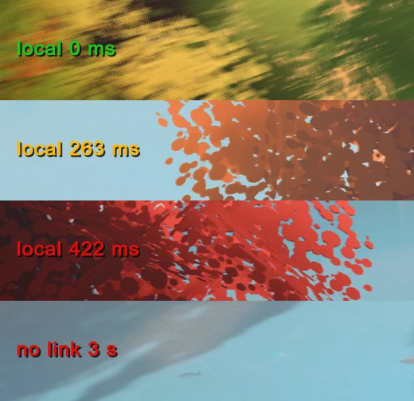

# Over the Hill LAN Co-op

<p align="center">
  <a href="https://github.com/Sergaris/over-the-hill-lan-coop/releases/latest"></a>
</p>

<h2 align="center"><a href="https://github.com/Sergaris/over-the-hill-lan-coop/releases/latest">⬇ Download OTH-LAN (latest release)</a></h2>

### How to download and install (no GitHub knowledge needed)

1. Open **[the latest release](https://github.com/Sergaris/over-the-hill-lan-coop/releases/latest)** (on the repository page it is also under **Releases** in the right-hand column).
2. Scroll down to **Assets** and click **`OTH-LAN-<version>.zip`**. Do **not** click "Source code (zip)" — that is the
   program code, not the mod.
3. Unpack the downloaded zip (right-click → *Extract All…*).
4. Close the game and run **`OTH-LAN-Setup.exe`**, then press **Install**.
5. Start Over The Hill from Steam and open **Main menu → Local Co-op**.

<details open>
<summary><b>Как скачать и установить (по-русски)</b></summary>

1. Откройте **[последний релиз](https://github.com/Sergaris/over-the-hill-lan-coop/releases/latest)** (на странице репозитория он также есть справа, в блоке **Releases**).
2. Прокрутите вниз до **Assets** и нажмите **`OTH-LAN-<версия>.zip`**. **Не** нажимайте «Source code (zip)» — это
   исходный код, а не мод.
3. Распакуйте скачанный архив (правой кнопкой → «Извлечь всё…»).
4. Закройте игру, запустите **`OTH-LAN-Setup.exe`** и нажмите **«Установить»**.
5. Запустите Over The Hill через Steam: **главное меню → «Локальный кооп»**.

</details>

---

Unofficial **LAN / virtual-LAN co-op mod for Over The Hill** (Steam App 2929250); the mod itself is called
**OTH-LAN**. Friends play the game's own multiplayer directly over a LAN or a virtual LAN (Radmin VPN, Hamachi, ZeroTier) instead of Photon Cloud. One player
hosts, the others pick the host from the **Local Co-op** list in the main menu or join by IP. ¹

> **Not affiliated with, endorsed by, or supported by Funselektor Labs or Exit Games (Photon).** This is a fan project.
> Do not contact the game's developers about problems caused by this mod: uninstall it first and check whether the
> problem persists. ²

## Screenshots

| | |
|---|---|
|  |  |
| *Main menu: the mod adds a **Local Co-op** button below Multiplayer.* | *Local Co-op: games on your LAN / virtual LAN with players, ping and mod version.* |
|  |  |
| *Hosting: pick 2–4 players and press **Become host**; the game's own region and area selection follows.* | *F7 window: connection status, manual IP join, ping, CarSync and own-car switches.* |
|  |  |
| *In a session: the friend's car next to yours, driven over the direct connection.* | *The ping label next to the game's connection icon: green ≤ 200 ms, yellow 200–300 ms, red > 300 ms, and "no link N s" when the host stops answering.* |
|  |  |
| *The mod follows the game's language: the same menu in Russian…* | *…and the Local Co-op screen in Russian.* |
|  |  |
| *F7 window in Russian.* | *The installer (shown under Wine; on Windows it uses the native look).* |

Screenshots were taken in demo mode with placeholder player names and addresses (Driver1/Driver2, 26.10.20.x).

## What it is and isn't

- **It is** a BepInEx 6 (IL2CPP) plugin plus a small Windows installer. Together they let the game's own Photon Fusion
  multiplayer run over a direct UDP connection to the host's (virtual) LAN IP.
- **It isn't** a crack, a way to play without owning the game, a cheat, a dedicated server or an internet matchmaking
  service. It contains **no game files**; every player needs their own legally purchased copy of Over The Hill.
- It does not modify any game file. It adds BepInEx next to the game, and the uninstaller restores the folder exactly.

## Requirements

- Windows 10/11 x64, Over The Hill from Steam. Every player must run the **same game build** and the **same mod
  version**; the client compares both with the host before joining and refuses with a message if they differ.
- A network all players share: a real LAN, or a virtual LAN such as Radmin VPN (https://www.radmin-vpn.com/),
  Hamachi (https://vpn.net/) or ZeroTier (https://www.zerotier.com/).
- Internet access on the first game start after installing: BepInEx downloads Unity's base libraries itself
  (from `unity.bepinex.dev`).

### Game versions

The mod is tested against the game builds listed in `manifest/supported-builds.json`. After a game update:
- if the networking code the mod hooks and the data layouts it reads are unchanged, the game asks once
  *"Game updated, not tested on this version"* — **Continue at own risk** or **Disable for now** (remembered per build);
- otherwise LAN mode stays off and F7 says the version is incompatible until the mod is updated.

## Install

1. Download `OTH-LAN-<version>.zip` from [Releases](https://github.com/Sergaris/over-the-hill-lan-coop/releases/latest) (under **Assets**, not "Source code") and unpack it.
2. Close the game and run `OTH-LAN-Setup.exe`. It finds the game through Steam (or you pick the folder with
   `over the hill.exe`), checks the game version, installs BepInEx 6 (be.788) and the plugin, and adds a firewall rule.
3. Start the game from Steam. The first start takes 1–3 minutes longer while BepInEx prepares itself.

The installer is not code-signed. If SmartScreen shows "Windows protected your PC", click *More info* → *Run anyway*,
but only for a file downloaded from this repository's [Releases](https://github.com/Sergaris/over-the-hill-lan-coop/releases) (compare the SHA-256 in the release notes).

**Why administrator rights?** The installer writes into the game folder (often under `Program Files`) and adds one
Windows Firewall rule for the game:

```
netsh advfirewall firewall add rule name="OTH-LAN UDP 27015" dir=in action=allow protocol=UDP localport=27015,27016 program="<game folder>\over the hill.exe" profile=any enable=yes
```

It changes nothing else system-wide. Files it would overwrite are backed up to `<game>/OTH-LAN/` first.

**Installer language:** the installer runs before the game, so it cannot know the game's language. It follows the
Windows display language (Russian if Windows is in Russian, English otherwise); `OTH-LAN-Setup.exe --lang en|ru`
overrides it.

## Play

1. Everyone joins the same LAN / virtual network.
2. **Host:** main menu → **Local Co-op** → **Become host** → choose 2–4 players, then the usual region and area selection.
3. **Others:** main menu → **Local Co-op**. Hosts on the network appear in the list with name, players, ping and
   mod version; select one and press **Join**. If a host does not show up (some VPN setups drop broadcasts), use
   **Add by IP** with the host's `IP:27015`.
4. **F7** opens the mod window: manual IP join, status, diagnostics and the CarSync switch (the host decides).
   F8 / F9 / F10 are shortcuts: arm hosting, join the last address, turn LAN mode off.

During a session the label next to the game's connection icon shows `local NN ms`, the direct ping to the host.

## Language

All mod texts (F7 window, Local Co-op screen, ping label, dialogs) follow the language selected in the game's
settings and switch immediately, without a restart. English and Russian are complete; other game languages fall back
to English. To add a language, copy `src/OthLan.Plugin/Lang/en.json` to `<code>.json` (the game's locale code, e.g.
`de`, `pt-BR`, `zh-Hans`) and translate the values — the unit tests check that keys and `{0}` placeholders match. ³

## Uninstall

Close the game, run `OTH-LAN-Setup.exe` and click **Uninstall**. It deletes every file it added, restores the backups
and removes the firewall rule. Afterwards Steam's *Verify integrity of game files* should find nothing to fix.

Manual install / uninstall without the installer is described in `OTH-LAN-MANUAL-INSTALL.txt` inside the manual zip.

## Ports

Only the host needs inbound UDP **27015** (game traffic) and **27016** (session info, player slots, ping, lobby
discovery). Clients need no rules.

## Known limits

- Up to 4 players, the host included.
- Tested mostly with scripted multi-instance runs on one PC plus a few real two-PC sessions. Expect rough edges with
  3–4 players and high ping.
- Client car positions are smoothed and compensated for packet loss by an optional sync layer (CarSync, on by
  default; see `docs/CAR-SYNC.md`). With high ping, cars can still slide or jump.
- No NAT traversal: players must be able to reach the host's IP over UDP.
- A game update can disable the mod until it is updated.
- Windows only; not tested under Proton/Wine.

## Building

Get the source:

```
git clone https://github.com/<owner>/over-the-hill-lan-coop.git
cd over-the-hill-lan-coop
```

You need the .NET 8 SDK and two inputs that are **never committed**:

1. the official BepInEx be.788 IL2CPP zip (URL and sha256 in `manifest/supported-builds.json`), unpacked to
   `third_party/bepinex-be788/` or anywhere you like;
2. interop assemblies generated by `tools/InteropGen` from **your own** installed copy of the game.

```
dotnet run --project tools/InteropGen -- "<game>/GameAssembly.dll" "<game>/over the hill_Data/il2cpp_data/Metadata/global-metadata.dat" 6000.0.75 <unity-base-libs-dir> <interop-out-dir>
dotnet build src/OthLan.Plugin -c Release -p:Interop=<interop-out-dir> -p:BepInExCore=<bepinex>/BepInEx/core
dotnet run --project tests/LogicTests -p:BepInExCore=<bepinex>/BepInEx/core
```

`<unity-base-libs-dir>` is Unity's base libraries for the game's Unity version, unzipped from
`https://unity.bepinex.dev/libraries/6000.0.75.zip` (the same files BepInEx downloads on first start).

`build.sh` does the same with the default locations (`interop/`, `third_party/`). `ARCHITECTURE.md` explains how
the mod works.

## About this project

The code was written with heavy help from AI coding assistants, then reviewed and tested by a human on real
hardware. Treat it like any other hobby project: read the code if unsure and report bugs in Issues.

## Licence

MIT, see `LICENSE`. The third-party components shipped in the release archives (BepInEx and its dependencies, the
.NET runtime) keep their own licences; see `THIRD-PARTY-NOTICES.md` and `LICENSES/`.

---

### Примечания по-русски

¹ Over the Hill LAN Co-op (мод OTH-LAN) — неофициальный мод для Over The Hill: кооператив по локальной сети или через Radmin VPN / Hamachi /
ZeroTier без Photon Cloud. Хост создаёт игру через кнопку **«Локальный кооп»** в главном меню, остальные выбирают его
в списке (или подключаются по IP через «Добавить по IP» / F7). У всех должны совпадать сборка игры и версия мода.

² Мод не связан с Funselektor Labs и Exit Games. Файлов игры в репозитории и релизах нет — нужна своя купленная копия.
Установщик пишет только в папку игры и добавляет одно правило брандмауэра (UDP 27015–27016); «Удалить» возвращает всё
как было. Язык установщика — по языку Windows, переключатель `--lang ru|en`.

³ Все тексты мода следуют языку, выбранному в настройках игры, и переключаются сразу, без перезапуска. Русский и
английский — полностью; остальные языки игры пока показываются по-английски. Перевод на новый язык — копия
`Lang/en.json` под кодом языка игры.
